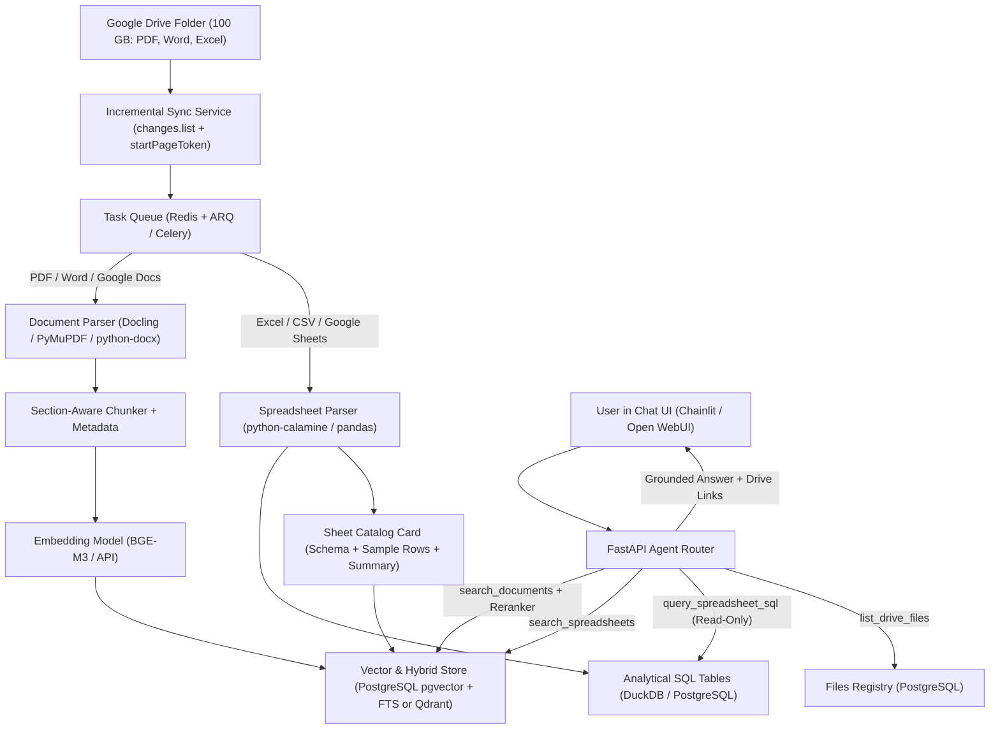

# Architecture & Implementation Plan: 100 GB Google Drive Hybrid RAG + Excel AI Assistant

## 1. Project Overview & Goals

Build a private, self-updating AI knowledge assistant connected to a **100 GB Google Drive folder** containing mixed formats: **PDFs** (digital and scanned), **Word documents** (`.docx`, `.doc`), **Excel spreadsheets** (`.xlsx`, `.xls`, `.csv` — including worksheets with **5,000+ rows**), and native Google Docs/Sheets.

### Core Requirements
- **Live Incremental Sync (Add / Edit / Delete):** Automatically detect newly added, edited, moved, or deleted/trashed files in the target Google Drive folder and update or purge indexed data so answers never rely on stale content.
- **Unstructured Document Q&A:** Accurately retrieve, synthesize, and answer questions across Word documents and PDFs using hybrid semantic + keyword search and reranking.
- **Exact Structured Spreadsheet Analytics:** Answer filtering, aggregation (`SUM`, `COUNT`, `AVG`, `GROUP BY`), ranking, and lookup queries against 5,000+ row Excel sheets via SQL rather than text chunking.
- **Verifiable Citations:** Every answer must cite source file names, page numbers or sheet names, and clickable Google Drive `webViewLink` URLs.
- **Resumable 100 GB Ingestion:** Support parallel, fault-tolerant initial backfill with checkpointing, rate-limit backoff, and dead-letter handling for corrupted files.

---

## 2. High-Level Architecture

The system splits ingestion and retrieval into two specialized paths—**Unstructured Vector/Hybrid RAG** for PDFs and Word files, and **Structured Catalog + SQL Execution** for Excel files—unified behind a tool-calling FastAPI Agent Router.



---

## 3. Recommended Tech Stack

For a **100 GB** dataset, pure no-code automation tools (such as n8n) are **not recommended** for the core ingestion engine because they struggle with multi-hour bulk backfills, retry checkpoints, memory spikes on large files, and reliable Excel-to-SQL table lifecycle management. A **custom Python stack** provides full reliability and significantly lower ongoing costs.

| Layer | Primary Recommendation | Rationale |
| :--- | :--- | :--- |
| **Google Drive Sync** | **Google Drive API v3** (`google-api-python-client`) | Uses `changes.list` with persisted `startPageToken` to detect adds, edits, moves, and deletions incrementally without rescanning 100 GB. |
| **Task Queue & Workers** | **Redis + ARQ** (or **Celery**) | Enables parallel ingestion workers, rate-limit retries, progress tracking, and resumable 100 GB backfills. |
| **PDF & Word Parsing** | **Docling** (IBM) + **PyMuPDF (`pymupdf4llm`)** + **`python-docx`** | Extracts clean Markdown, headings, and tables locally with built-in OCR fallback for scanned PDFs—avoiding high per-page cloud parsing fees at 100 GB. |
| **Excel Parsing & SQL Engine** | **`python-calamine` + `pandas`** -> **DuckDB** (or **PostgreSQL**) | `python-calamine` reads large `.xlsx` files rapidly; DuckDB executes analytical SQL over 5,000+ row tables in milliseconds. |
| **Metadata, Sync State & Vector Store** | **PostgreSQL (`pgvector` + `tsvector`)** *(or **Qdrant** for vectors + PostgreSQL for state)* | Keeping `files_registry`, `sync_state`, `spreadsheet_catalog`, and `document_chunks` in PostgreSQL simplifies transactional deletes by `file_id`. Swap vectors to Qdrant if chunk volume exceeds tens of millions. |
| **Reranker** | **`BAAI/bge-reranker-v2-m3`** (self-hosted) or **Cohere Rerank 3.5** | Crucial at 100 GB scale: narrows top-40 hybrid candidates down to top-8 high-precision passages. |
| **Backend & Agent Framework** | **Python 3.11+ / FastAPI + PydanticAI** (or **LangGraph**) | Clean async API with strict typed schemas for tool calling, read-only SQL validation, and streaming responses. |
| **Chat UI** | **Chainlit** or **Open WebUI** *(or **Next.js** later)* | Fast to deploy with native markdown rendering, source citation panels, and streaming chat. |
| **Observability** | **Langfuse** (or **Arize Phoenix**) + structured JSON logs | Traces tool calls, retrieved chunks, generated SQL, latency, and token spend per query. |

### Alternative: Managed Cloud Stack (Google Cloud Native)
If engineering bandwidth is minimal and cloud budget is flexible:
- **Unstructured:** Google Drive -> Cloud Storage -> **Document AI** -> **Vertex AI RAG Engine** / Vector Search.
- **Structured:** Sync Excel sheets to **BigQuery**; route questions using **Vertex AI Agent Builder / ADK**.
- **Trade-off:** Faster initial wiring, but Document AI OCR + managed indexing across 100 GB can become expensive compared to self-hosted parsing and `bge-m3`.

---

## 4. AI Model Recommendations

At 100 GB scale, split model selection across three distinct roles to balance accuracy, latency, and ingestion cost.

| Role | Cloud Recommended (Best Accuracy & Speed) | 100% Private / Self-Hosted Alternative | Notes |
| :--- | :--- | :--- | :--- |
| **Primary Agent & SQL LLM** | **Gemini 2.5 Pro** *(huge 1M+ context, strong tool use)* or **Claude Sonnet 4 / 4.5** *(top-tier SQL accuracy & low hallucination)* | **Qwen 2.5 / Qwen 3 (32B or 72B)** or **Llama 3.3 70B** via **vLLM** | Use a two-tier setup: route simple lookups/summaries to **Gemini 2.5 Flash** (or `GPT-4.1-mini`) and complex SQL / multi-doc reasoning to the flagship model. |
| **Embedding Model** | **Google `gemini-embedding-001`**, **OpenAI `text-embedding-3-small`**, or **Voyage AI `voyage-3`** | **`BAAI/bge-m3`** *(Recommended for 100 GB)* | `bge-m3` generates both dense and sparse vectors in one pass and avoids large upfront per-token API bills on 100 GB (can be run on a rented GPU for a few hours during backfill). |
| **Reranker** | **Cohere Rerank 3.5** or **Voyage Rerank** | **`BAAI/bge-reranker-v2-m3`** | Always rerank before passing chunks to the LLM to prevent context pollution across thousands of files. |

---

## 5. Data Model & Storage Schema

All indexed artifacts trace back to Google Drive's immutable `file_id` so edits and deletions cascade cleanly.

### 5.1 `sync_state`
Tracks incremental sync checkpoints per monitored root folder.
- `id` (PK)
- `root_folder_id` (text)
- `drive_start_page_token` (text) — updated only after a `changes.list` page is successfully enqueued
- `last_sync_at` (timestamptz)

### 5.2 `files_registry`
Authoritative state of every file discovered in the 100 GB folder tree.
- `file_id` (PK, text — Google Drive file ID)
- `file_name` (text)
- `folder_path` (text — resolved breadcrumb path, e.g., `/Finance/2025/Q1`)
- `mime_type` (text)
- `size_bytes` (bigint)
- `md5_checksum` (text — nullable for native Google Docs/Sheets)
- `modified_time` (timestamptz)
- `web_view_link` (text)
- `sync_status` (enum: `pending`, `indexing`, `indexed`, `failed`, `deleted`)
- `error_message` (text, nullable)
- `last_indexed_at` (timestamptz)

### 5.3 `document_chunks`
Stores parsed text chunks for PDFs, Word documents, and Google Docs.
- `chunk_id` (PK, uuid)
- `file_id` (FK -> `files_registry.file_id`, indexed for fast deletion)
- `chunk_index` (int)
- `page_number` (int, nullable)
- `section_heading` (text, nullable)
- `content` (text)
- `embedding` (`vector(1024)` for `bge-m3`)
- `tsv` (`tsvector` generated column for PostgreSQL full-text / BM25-style keyword search)
- `metadata` (`jsonb`: `file_name`, `folder_path`, `web_view_link`, `modified_time`)

### 5.4 `spreadsheet_catalog` & Per-Sheet SQL Tables
Stores searchable metadata for every worksheet inside every Excel/CSV/Google Sheet file.
- **Catalog Table (`spreadsheet_catalog`):**
  - `catalog_id` (PK, uuid)
  - `file_id` (FK -> `files_registry.file_id`, indexed)
  - `file_name` (text)
  - `sheet_name` (text)
  - `sql_table_name` (text, unique — naming convention: `xl_<short_file_id>_<sanitized_sheet>`)
  - `row_count` (int)
  - `columns_json` (`jsonb` — normalized column names, inferred types, original header names)
  - `sample_rows_json` (`jsonb` — first 3–5 representative rows)
  - `summary_text` (text — concise description of file + sheet + columns for retrieval)
  - `embedding` (`vector(1024)`)
- **Per-Sheet Data Tables (`xl_<short_file_id>_<sanitized_sheet>`):**
  - Hosted in **DuckDB** (or a dedicated PostgreSQL schema `spreadsheets`) with normalized column names and typed columns (`TEXT`, `DOUBLE`, `BIGINT`, `DATE`, `TIMESTAMP`).

---

## 6. Google Drive Sync & Lifecycle (Add / Edit / Delete)

### 6.1 Initial 100 GB Backfill
1. Recursively traverse the target `root_folder_id` using `files.list` (paginated, `supportsAllDrives=True`, `includeItemsFromAllDrives=True`).
2. Record all valid files in `files_registry` with `sync_status='pending'` and save the initial `getStartPageToken()` **before** or **at the start** of the crawl so changes occurring mid-backfill are captured.
3. Enqueue indexing jobs into Redis (`ARQ`/`Celery`) prioritized by file size or folder, with exponential backoff on Google Drive `403/429` rate limits.
4. Route repeatedly failing or password-protected/corrupted files to a dead-letter state (`sync_status='failed'`) with `error_message` logged for review.

### 6.2 Incremental Sync Loop
- Run a scheduled sync job every **5–15 minutes** (optionally paired with Google Drive `changes.watch` push webhooks for near-real-time triggers, keeping polling as the reliable fallback).
- Call `drive.changes().list(pageToken=drive_start_page_token, spaces='drive', includeRemoved=True, supportsAllDrives=True)`.
- Filter changes to items whose parent ancestry traces back to `root_folder_id` (or are already tracked in `files_registry`).

### 6.3 Lifecycle Handlers
- **Add (new file inside target folder):**
  - Upsert `files_registry` (`pending`) -> download binary (`files.get_media`) or export native Google Workspace files (`files.export` to `.docx`/`.xlsx`/`.pdf`) -> parse -> index chunks or SQL tables -> mark `indexed`.
- **Edit (existing `file_id` with changed `md5Checksum` or `modifiedTime`, or renamed/moved within folder):**
  - If only `file_name` or `folder_path` changed without content change, update metadata in `files_registry`, `document_chunks.metadata`, and `spreadsheet_catalog`.
  - If content changed: **atomically purge old data first** (delete all `document_chunks` where `file_id = X`, or `DROP TABLE` for old `xl_<short_id>_*` tables and delete `spreadsheet_catalog` rows where `file_id = X`), then re-ingest the new version.
- **Delete / Trash / Move Outside Target Folder (`removed == True`, `trashed == True`, or parent no longer under `root_folder_id`):**
  - Delete all `document_chunks` by `file_id`.
  - Drop all associated `xl_*` SQL tables and delete `spreadsheet_catalog` entries by `file_id`.
  - Update `files_registry` status to `deleted` (or remove record).

---

## 7. Handling 5,000+ Row Excel Files Reliably

Text chunking breaks on 5,000-row spreadsheets because rows detach from headers and vector search cannot perform exact arithmetic.

### 7.1 Ingestion Cleanup Pipeline
1. **Sheet-by-Sheet Processing:** Iterate over every worksheet in the workbook; index each non-empty sheet as its own catalog entry and SQL table.
2. **Smart Header Detection:** Scan the top 15 rows to locate the true header row (skipping banner titles, blank lines, or report timestamps) and unmerge/forward-fill merged header cells where needed.
3. **Column Normalization:** Convert headers to deterministic `snake_case` SQL-safe identifiers (deduplicating repeated names like `amount`, `amount_2`) while storing a mapping back to the original Excel column header in `columns_json`.
4. **Type Inference:** Clean currency symbols, commas, percentage strings, and Excel serial dates so numeric aggregations (`SUM`, `AVG`, `MIN`, `MAX`) and date filters (`BETWEEN`) work natively in SQL.

### 7.2 Safe SQL Query Execution Flow
1. User asks a spreadsheet question (e.g., *"What was the total revenue for Region East in Q3 inside `sales_2025.xlsx`?"*).
2. Agent searches `spreadsheet_catalog` -> retrieves matching table(s) -> calls `describe_spreadsheet(sql_table_name)` to inspect exact column names, types, and sample rows.
3. LLM generates a SQL `SELECT` query targeting that exact table.
4. **SQL Guardrails (Mandatory):**
   - Parse query via `sqlglot` AST validator: **allow `SELECT` / `WITH` only**; reject `INSERT`, `UPDATE`, `DELETE`, `DROP`, `ATTACH`, `COPY`, or system table access.
   - Execute using a **read-only** database connection.
   - Enforce a **5–10 second query timeout** and automatic **row cap** (e.g., `LIMIT 200` on raw row returns; aggregations return exact totals).
   - If SQL execution fails (e.g., wrong column cast), return the exact DB error to the LLM for up to **2 automatic self-correction retries**.

---

## 8. Agent Tools & Query Pipeline

The FastAPI agent exposes five explicit tools to the LLM:

1. `search_documents(query, folder_filter=None, file_type=None, top_k=8)`
   - Runs hybrid search (dense vector similarity + keyword `tsvector`/sparse fusion) across `document_chunks`, then applies the reranker (`top 40 -> top 8`).
2. `search_spreadsheets(query, top_k=5)`
   - Searches `spreadsheet_catalog` by file name, sheet name, column names, and summary to identify candidate SQL tables.
3. `describe_spreadsheet(sql_table_name)`
   - Returns exact SQL schema, original column names, row count, and 5 sample rows before writing SQL.
4. `query_spreadsheet_sql(sql_query)`
   - Validates AST + executes read-only SQL against DuckDB/PostgreSQL and returns structured rows + execution metadata.
5. `list_drive_files(name_query=None, folder_path=None, file_type=None, limit=50)`
   - Queries `files_registry` directly for metadata questions (*"Which Excel files are in the HR folder?"* or *"When was `policy.pdf` last updated?"*).

### Grounding & Citation Rules
- Every factual claim or number returned to the user must include the source **file name**, **page number** (for PDFs) or **sheet name** (for Excel), and clickable **`webViewLink`**.
- If neither document search nor SQL queries contain the answer, the agent must explicitly state that the information was not found in the indexed Google Drive files rather than guessing.

---

## 9. Proposed Repository Structure

```text
ai-assistant/
├── app/
│   ├── api/                  # FastAPI routes (chat, health, sync status, admin)
│   ├── agent/                # LLM router, system prompts, tool definitions, citation formatter
│   ├── sync/                 # Google Drive v3 client, recursive crawler, changes.list watcher
│   ├── parsers/              # Docling/PyMuPDF PDF parser, python-docx parser, calamine Excel loader
│   ├── db/                   # PostgreSQL models, pgvector queries, DuckDB read-only executor + AST guard
│   ├── workers/              # ARQ/Celery worker tasks (ingest_file, delete_file, incremental_sync)
│   └── core/                 # Config (pydantic-settings), logging, retry helpers
├── scripts/
│   ├── audit_drive.py        # Pre-flight script to count files, sizes, MIME types, and PDF text vs scan ratio
│   └── run_backfill.py       # CLI entrypoint to start/resume 100 GB backfill
├── tests/
│   ├── test_excel_sql.py     # Header detection, 5,000-row aggregation accuracy, SQL guardrails
│   ├── test_sync_lifecycle.py# Add / Edit / Delete propagation tests
│   └── eval_golden_set.py    # End-to-end RAG & SQL accuracy benchmark
├── docker-compose.yml        # PostgreSQL (pgvector), Redis, FastAPI, Worker, Chat UI
├── .env.example              # Drive credentials path, DB URLs, model API keys
└── pyproject.toml            # Python dependencies managed via uv
```

---

## 10. Phased Implementation Roadmap

### Phase 0: Drive Audit & 1 GB Pilot Setup
- Run a read-only audit script (`scripts/audit_drive.py`) against the 100 GB folder to measure exact file counts by type (`.pdf`, `.docx`, `.xlsx`, native Google files), total pages, and estimate how many PDFs are scanned images requiring OCR.
- Create a **1 GB pilot folder** with 20–50 representative files (messy Word docs, scanned + digital PDFs, and multiple 5,000+ row Excel workbooks).

### Phase 1: Core Infrastructure & Drive Sync Engine
- Set up `docker-compose.yml` with PostgreSQL (`pgvector`), Redis, and Python (`uv`) environment.
- Implement database schemas (`sync_state`, `files_registry`, `document_chunks`, `spreadsheet_catalog`).
- Configure Google Drive API credentials (Service Account for Workspace Shared Drives or OAuth2 for personal Drive) and build the recursive crawler + `changes.list` incremental sync job.

### Phase 2: Document & Excel Ingestion Pipelines
- Implement PDF (`Docling` / `PyMuPDF`) and Word (`python-docx`) extraction + section-aware chunking + embedding generation.
- Implement Excel (`python-calamine`) smart header detection, type inference, DuckDB/Postgres table loader, and catalog card generator.
- Verify **Add**, **Edit**, and **Delete** propagation end-to-end on the pilot folder (confirming zero stale chunks or orphaned SQL tables).

### Phase 3: Hybrid Retrieval, Reranking & Agent API
- Implement hybrid vector + full-text search and reranker integration (`bge-reranker-v2-m3` or Cohere).
- Implement read-only SQL executor with `sqlglot` AST validation, timeouts, row limits, and self-correction retries.
- Build the FastAPI agent router with streaming responses and clickable Drive `webViewLink` citations.

### Phase 4: Chat UI & Accuracy Evaluation
- Connect **Chainlit** or **Open WebUI** to the FastAPI backend.
- Build a golden evaluation suite of 30–50 real questions (cross-document lookup, exact `SUM`/`GROUP BY` on 5,000-row Excels, and post-edit/post-delete freshness checks) and tune chunk sizes/prompts until accuracy meets target.

### Phase 5: 100 GB Scale-Up & Hardening
- Run full 100 GB backfill using parallel workers (optionally spinning up a temporary cloud GPU instance for fast `bge-m3` embedding + `Docling` OCR).
- Add monitoring dashboards, dead-letter retry tooling for failed files, automated DB backups, and (if multi-user) per-user Google Drive permission/ACL filtering.

---

## 11. Key Risks, Cost Drivers & Mitigations

| Risk / Cost Driver | Impact at 100 GB | Mitigation |
| :--- | :--- | :--- |
| **Scanned / Image-Heavy PDFs** | High OCR latency and cost if using per-page paid APIs | Audit scan ratio in Phase 0; run **Docling** / local OCR on GPU workers rather than paid per-page APIs for bulk backfill. |
| **100 GB Embedding Cost** | High upfront API spend if sending tens of millions of tokens to commercial APIs | Use self-hosted **`BAAI/bge-m3`** on a temporary rented GPU for initial backfill, keeping ongoing incremental sync costs near zero. |
| **Google Drive API Rate Limits** | `403/429` throttling during initial download of thousands of files | Use exponential backoff, limit concurrent Drive downloads (e.g., 5–10 workers), and checkpoint `files_registry` per file. |
| **Messy Real-World Excel Sheets** | Merged headers, title banners, mixed currency strings break naive loaders | Implement top-15-row header detection, column type coercion with safe string fallback, and per-sheet catalog inspection before SQL generation. |
| **Orphaned Data on Partial Edit Failure** | Stale chunks or duplicate SQL rows appear in answers | Wrap chunk/table deletion + replacement cleanly by `file_id`; never mark `indexed` until commit succeeds. |
| **Multi-User Access Control (ACLs)** | Users might query files they cannot open in Google Drive | If deploying to a team, store Drive permission IDs in `files_registry` and filter vector/catalog queries by the signed-in user's Google identity. |

---

## 12. Open Decisions Before Coding

Lock down these five choices before starting Phase 1:

1. **Data Privacy Policy:** Can document text and spreadsheet query results be sent to cloud LLM APIs (Gemini / Claude), or must all models run 100% locally/on-prem (`vLLM` + `bge-m3`)?
2. **Drive Account Type:** Is the 100 GB folder in a **personal Google Drive** (OAuth2 desktop/web flow) or a **Google Workspace Shared Drive** (Service Account)?
3. **Hosting Environment:** Will this run on a local workstation/server (with or without an NVIDIA GPU), a single cloud VM, or managed cloud infrastructure (GCP/AWS)?
4. **Access Scope:** Is this a **single-user** assistant (full access to the 100 GB folder) or **multi-user** (requiring per-user Google Drive permission enforcement)?
5. **Monthly Budget Target:** Target ongoing monthly spend for hosting and LLM inference.
