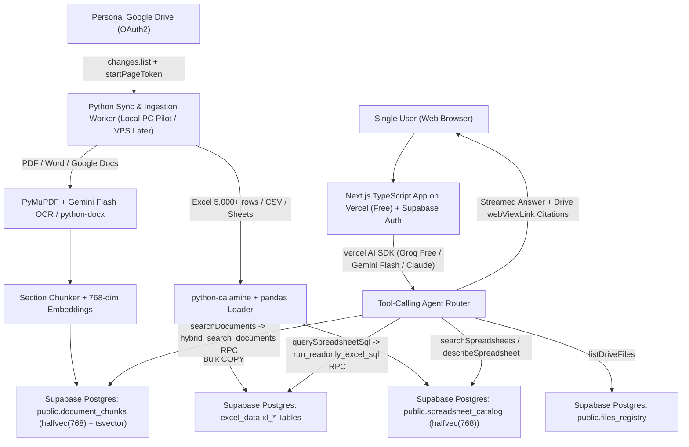

# Architecture & Implementation Plan: Google Drive Hybrid RAG + Excel AI Assistant

## 1. Project Overview & Goals

Build a **single-user** AI knowledge assistant connected to a **personal Google Drive account** containing up to **100 GB** of **PDFs** (digital and scanned), **Word documents** (`.docx`, `.doc`), **Excel spreadsheets** (`.xlsx`, `.xls`, `.csv` — including worksheets with **5,000+ rows**), and native Google Docs/Sheets. Cloud LLM APIs (Groq, Gemini, Claude) are approved.

### Two-Stage Rollout Strategy
- **Stage A — \$0/mo Pilot (~200 MB–1 GB subset within Supabase Free 500 MB DB cap):**
  Validate end-to-end accuracy across real PDFs, Word docs, and 5,000-row Excel files using **Vercel Hobby (Free)** + **Supabase (Free)** + **Groq / Gemini Free Tier** + a **local Python ingestion worker**.
- **Stage B — 100 GB Full Scale-Up:**
  Once pilot accuracy is validated, swap `DATABASE_URL` to either **Supabase Pro** or a low-cost **VPS (\$10–\$20/mo) running PostgreSQL + `pgvector` + the 24/7 Python sync worker**, and optionally enable cheap/flagship production models with zero application rewrite.

### Core Requirements
- **Live Incremental Sync (Add / Edit / Delete):** Track personal Google Drive `changes.list` (`startPageToken`) so newly added, edited, renamed, moved, or trashed/deleted files update or purge cleanly without leaving stale answers.
- **Unstructured Document Q&A:** Answer questions across Word and PDF documents using PostgreSQL hybrid search (`pgvector` `halfvec` cosine similarity + `tsvector` keyword search via Reciprocal Rank Fusion).
- **Exact Structured Spreadsheet Analytics:** Answer filtering, aggregation (`SUM`, `COUNT`, `AVG`, `GROUP BY`), ranking, and row lookups on 5,000+ row Excel sheets via read-only SQL rather than text chunking.
- **Verifiable Citations:** Every answer cites the source file name, page number or sheet name, and clickable Google Drive `webViewLink`.

---

## 2. High-Level Architecture

The architecture separates **heavy ingestion** from **lightweight chat**, so Vercel's serverless timeout limits (10s–60s) are never hit and you can chat 24/7 from any browser even when your local PC is off.



### Why This Split Works
- **TypeScript + Next.js on Vercel (Free):** Ideal for the chat UI, Supabase Auth gate, streaming responses, and fast AI SDK tool calls to Supabase RPCs.
- **Python Worker (Local PC for \$0 Pilot -> VPS for 100 GB):** Ideal for `google-api-python-client`, PDF/OCR extraction, `python-docx`, and `python-calamine` Excel parsing—tasks that exceed Vercel serverless memory and execution limits.
- **24/7 Chat Availability:** All parsed chunks, `halfvec(768)` vectors, and Excel SQL tables live inside **Supabase PostgreSQL**, so the Vercel web app works from anywhere even when the Python worker PC is offline. Python only needs to run when syncing Drive changes.

---

## 3. Recommended Tech Stack (Locked-In Hybrid Stack)

| Layer | Locked-In Choice | Rationale |
| :--- | :--- | :--- |
| **Chat UI & Agent Backend** | **Next.js (App Router, TypeScript) + Vercel AI SDK** on **Vercel Hobby (Free)** | Streaming chat UI, single codebase for frontend + `/api/chat`, and provider-agnostic AI SDK (swap Groq / Gemini / Claude via env vars). |
| **Database, Vectors & Excel SQL** | **Supabase (PostgreSQL + `pgvector` `halfvec(768)` + `tsvector` + `excel_data` schema)** | One managed Postgres database stores sync state, 16-bit half-precision vector chunks, full-text search indexes, spreadsheet catalogs, and 5,000-row Excel tables. |
| **Authentication** | **Supabase Auth** (Single whitelisted email + RLS) | Protects your Vercel URL so only your account can access your Drive knowledge base. |
| **Drive Sync & File Parsers** | **Python 3.11+ (`uv`)** with `google-api-python-client`, `PyMuPDF` + Gemini Flash OCR, `python-docx`, `python-calamine`, `pandas`, `psycopg` | Fast local parsing with smart OCR only on scanned pages (`< 30` chars). Run manually or on Windows Task Scheduler during pilot; move to a cheap VPS for 24/7 sync at 100 GB. |
| **Hybrid Search Ranking** | **PostgreSQL Reciprocal Rank Fusion (RRF)** RPC | Combines `halfvec(768)` semantic similarity and `tsvector` keyword ranking directly in SQL—zero extra paid reranker needed during the free pilot. |

### Free-Tier & Storage Reality Check (1 GB Pilot vs. 100 GB Scale)
- **Raw Drive files are NEVER stored in Supabase:** Your PDFs, Word docs, and Excel binaries stay in Google Drive. Supabase stores only extracted plain text, `halfvec(768)` embeddings, search indexes, and structured Excel SQL rows.
- **16-bit `halfvec(768)` Storage Optimization (~50% Savings):** Using `pgvector` `halfvec(768)` (`halfvec_cosine_ops` HNSW index) instead of 32-bit `vector(768)` cuts vector and HNSW index storage in **half** with virtually zero recall loss.
- **Realistic Supabase Size vs. 100 GB in Google Drive:**
  - **Pilot (9 files / 12.32 MB in Drive):** Shrinks to roughly **~5–8 MB** in Supabase (~1% of the 500 MB free tier). A **1 GB pilot** of similar files fits comfortably inside Supabase Free (500 MB).
  - **Full 100 GB (mostly scanned PDFs & image-heavy Word docs, like our Phase 0 audit):** Shrinks **10×–50×** down to roughly **~2 GB – 10 GB** in Supabase (if mostly pure dense text + huge raw Excel tables, expect **~15 GB – 40 GB**).
- **Scaling Beyond 500 MB:** Supabase Free pauses after 7 days of inactivity and caps DB storage at 500 MB. Because our app uses standard PostgreSQL + `pgvector`, moving to 100 GB only requires changing `DATABASE_URL` to Supabase Pro or a \$10–\$20/mo self-hosted Postgres VPS.

---

## 4. AI Model Progression (Free Pilot -> Cheap Production -> Flagship)

Because **Vercel AI SDK** abstracts model providers behind one interface, you can switch models in minutes via environment variables or a UI model selector.

| Role | Stage A: Free Pilot (\$0/mo) | Stage B: Cheap Production | Stage C: Optional "Deep Mode" |
| :--- | :--- | :--- | :--- |
| **Primary Agent & SQL LLM** | **Groq Free Tier** (`llama-3.3-70b-versatile` or `qwen/qwen3-32b`) — ultra-fast tool calling & SQL generation | **Gemini 2.5 Flash**, **DeepSeek**, or **GPT-4.1-mini** (pennies/day for single-user usage) | **Gemini 2.5 Pro** or **Claude Sonnet 4 / 4.5** for complex multi-file synthesis or tricky SQL joins |
| **Free Large-Context Fallback & Scanned PDF OCR** | **Google AI Studio Free Tier (`Gemini 2.5 Flash`)** — fallback for large queries and multimodal OCR on scanned PDFs (like `90th-PMC-MEETING-APPROVED.pdf` found in Phase 0) | Same (`Gemini 2.5 Flash` paid tier or local GPU OCR like `Docling` for 100 GB bulk backfill) | — |
| **Embedding Model** | **`gemini-embedding-001` (`output_dimensionality=768`, stored as `halfvec(768)`)** — Free Tier | Local GPU **`BAAI/bge-m3`** or `gemini-embedding-001` (stored as `halfvec`) for full 100 GB backfill | — |
| **Ranking / Reranker** | **PostgreSQL RRF** (`halfvec(768)` + `tsvector` inside Supabase RPC, \$0) | Optional **Cohere Rerank** or self-hosted `BAAI/bge-reranker-v2-m3` | — |

> **Groq Free-Tier Optimization:** Groq's free tier enforces strict **Tokens Per Minute (TPM)** caps. Keep `top_k` compact (e.g., 5–6 chunks max, ~400–600 tokens per chunk) and pass only relevant table schemas to `querySpreadsheetSql` so queries stay fast and avoid rate-limit errors.

---

## 5. Data Model & Supabase Storage Schema

All indexed data links back to Google Drive's immutable `file_id` so edits and deletions cascade cleanly.

### 5.1 `public.sync_state`
Tracks incremental sync checkpoints for the monitored personal Drive folder.
- `id` (PK, `int`)
- `root_folder_id` (text)
- `drive_start_page_token` (text) — saved only after a `changes.list` page finishes processing
- `last_sync_at` (timestamptz)

### 5.2 `public.files_registry`
Authoritative inventory of every file discovered in the Drive folder tree.
- `file_id` (PK, text)
- `file_name` (text)
- `folder_path` (text — e.g., `/PCC-AI assistant`)
- `mime_type` (text)
- `size_bytes` (bigint)
- `md5_checksum` (text, nullable for native Google Docs/Sheets)
- `modified_time` (timestamptz)
- `web_view_link` (text)
- `sync_status` (enum: `pending`, `indexing`, `indexed`, `failed`, `deleted`)
- `error_message` (text, nullable)
- `last_indexed_at` (timestamptz)

### 5.3 `public.document_chunks`
Stores parsed text chunks for PDFs, Word files, and exported Google Docs.
- `chunk_id` (PK, `uuid`)
- `file_id` (FK -> `public.files_registry(file_id)` `ON DELETE CASCADE`, indexed)
- `chunk_index` (int)
- `page_number` (int, nullable)
- `section_heading` (text, nullable)
- `content` (text)
- `embedding` (`halfvec(768)` for `gemini-embedding-001`, indexed with HNSW `halfvec_cosine_ops`)
- `tsv` (`tsvector` generated column `to_tsvector('english', coalesce(section_heading, '') || ' ' || content)` with GIN index)
- `metadata` (`jsonb`: `file_name`, `folder_path`, `web_view_link`, `modified_time`)

### 5.4 `public.spreadsheet_catalog` & `excel_data.xl_*` Tables
- **Catalog (`public.spreadsheet_catalog`):**
  - `catalog_id` (PK, `uuid`)
  - `file_id` (FK -> `public.files_registry(file_id)` `ON DELETE CASCADE`, indexed)
  - `file_name` (text)
  - `sheet_name` (text)
  - `sql_table_name` (text, unique — naming convention: `excel_data.xl_<short_file_id>_<sanitized_sheet>`)
  - `row_count` (int)
  - `columns_json` (`jsonb` — normalized SQL column names, Postgres types, original Excel headers)
  - `sample_rows_json` (`jsonb` — 3–5 representative rows)
  - `summary_text` (text)
  - `embedding` (`halfvec(768)` with HNSW `halfvec_cosine_ops` index)
- **Per-Sheet Data Tables (`excel_data.xl_<short_file_id>_<sanitized_sheet>`):**
  - Stored in a dedicated PostgreSQL schema **`excel_data`** isolated from `public` system/auth tables.

### 5.5 Supabase RPC Functions (Called from TypeScript)
- `hybrid_search_documents(query_text, query_embedding halfvec(768), match_count, folder_filter, file_type_filter)` — executes `halfvec(768)` cosine search + `tsvector` rank combined via **Reciprocal Rank Fusion (RRF)** and returns top chunks with `web_view_link`.
- `search_spreadsheets(query_text, query_embedding halfvec(768), match_count)` — matches candidate sheets in `public.spreadsheet_catalog`.
- `run_readonly_excel_sql(query_text, max_rows)` — `security definer` function running with `SET LOCAL statement_timeout = '8000'`, restricted strictly to single `SELECT`/`WITH` queries referencing `excel_data.` tables, capped at 200 rows.

---

## 6. Personal Google Drive Sync & Lifecycle (OAuth2 + Add / Edit / Delete)

### 6.1 Personal Drive Authentication (OAuth 2.0)
- Configured in Google Cloud Project `PCC AI Assistant` (`pcc-ai-assistant`) with Desktop App OAuth2 (`drive.readonly` scope).
- **Important OAuth Pitfall:** While the OAuth Consent Screen stays in **"Testing"** status, refresh tokens expire every **7 days**. Once Vercel deploys in Phase 3 (providing a Homepage URL and Privacy Policy URL), add those URLs under Google Auth Platform Branding and switch publishing status to **"In Production"** (kept private to your account) so refresh tokens remain long-lived.

### 6.2 Initial Backfill & Incremental `changes.list` Sync
1. **Initial Crawl:** Call `drive.changes().getStartPageToken()` first, then recursively traverse `root_folder_id` with `files.list` and populate `public.files_registry` (`pending`).
2. **Incremental Sync:** Run `sync_once.py` (or a scheduled loop) calling `drive.changes().list(pageToken=drive_start_page_token, includeRemoved=True)`.
3. **File Handling by Type:**
   - Binary files (`.pdf`, `.docx`, `.xlsx`, `.csv`): download via `files.get_media`.
   - Native Google Docs / Sheets: export via `files.export` (`.docx` / `.xlsx`).

### 6.3 Add / Edit / Delete Propagation
- **Add (new file in target folder):** Insert `files_registry` -> parse -> embed/load to Supabase -> mark `indexed`.
- **Edit (same `file_id`, changed `md5Checksum` or `modifiedTime`):**
  - **Metadata-only rename/move:** Update `files_registry`, `document_chunks.metadata`, and `spreadsheet_catalog` without re-embedding.
  - **Content changed:** Purge old `document_chunks` where `file_id = X`, or `DROP TABLE IF EXISTS excel_data.<old_table>` + delete `spreadsheet_catalog` rows where `file_id = X`, then re-index the updated file cleanly.
- **Delete / Trash / Move Outside Folder:** Delete `document_chunks` by `file_id`, drop associated `excel_data.xl_*` tables, delete `spreadsheet_catalog` rows, and mark `files_registry.sync_status = 'deleted'`.

---

## 7. Handling 5,000+ Row Excel Files in Supabase

### 7.1 Python Ingestion Cleanup
1. Process every non-empty worksheet individually via `python-calamine` (fast Rust-backed `.xlsx` reader) + `pandas`.
2. Scan the top 15 rows to locate the true header row (skipping banner titles, blank rows, or merged cells).
3. Normalize headers to unique `snake_case` PostgreSQL column names while preserving original headers in `columns_json`.
4. Clean currency symbols, commas, percentage strings, and Excel dates, then bulk-insert into `excel_data.xl_<short_file_id>_<sanitized_sheet>` using PostgreSQL `COPY` (5,000 rows load in under a second).

### 7.2 Safe SQL Execution from Vercel TypeScript
1. User asks a spreadsheet question (e.g., *"What is the total allocation by region in `PCC-Allocation-List.xlsx`?"*).
2. Agent calls `searchSpreadsheets` -> `describeSpreadsheet` to inspect exact column names, Postgres types, and 5 sample rows.
3. LLM writes a PostgreSQL `SELECT` query targeting `excel_data.xl_...`.
4. **SQL Guardrails (Dual Layer):**
   - **App layer (TypeScript):** Reject anything that isn't a single `SELECT` or `WITH` statement; block `INSERT`, `UPDATE`, `DELETE`, `DROP`, `ALTER`, `COPY`, `pg_catalog`, `information_schema`, or `auth.*`. Require `excel_data.` table qualification.
   - **DB layer (Supabase RPC):** Runs with `SET LOCAL statement_timeout = '8000'`, strict regex validation, and a 200-row output cap.
   - If Postgres returns a syntax/type error, feed the error back to the LLM for up to **2 automatic self-correction retries**.

---

## 8. Agent Tools & Query Pipeline (TypeScript + Vercel AI SDK)

The Next.js `/api/chat` route exposes five compact tools to the LLM:

1. `searchDocuments({ query, folderFilter?, fileType?, topK = 6 })`
   - Calls `hybrid_search_documents` RPC in Supabase and returns ranked text excerpts, `file_name`, `page_number`, and `web_view_link`.
2. `searchSpreadsheets({ query, topK = 5 })`
   - Calls `search_spreadsheets` RPC in Supabase to locate relevant Excel sheets.
3. `describeSpreadsheet({ sqlTableName })`
   - Fetches exact `columns_json`, `row_count`, and `sample_rows_json` from `public.spreadsheet_catalog`.
4. `querySpreadsheetSql({ sqlQuery })`
   - Validates SQL guardrails in TypeScript -> executes `run_readonly_excel_sql` RPC -> returns JSON rows.
5. `listDriveFiles({ nameQuery?, folderPath?, fileType?, limit = 30 })`
   - Queries `public.files_registry` directly for inventory/freshness questions (*"Which Excel masterlists are in Drive?"*).

### Grounding & Citation Rules
- Every factual claim or calculation must cite the exact **file name**, **page number** (PDF) or **sheet name** (Excel), and clickable **`webViewLink`**.
- Never fabricate numbers or answers when tool outputs are empty—explicitly report what was searched and not found.

---

## 9. Proposed Monorepo Structure

```text
ai-assistant/
├── web/                              # Next.js (TypeScript) Chat UI + API on Vercel Free
│   ├── src/app/
│   │   ├── api/chat/route.ts         # Vercel AI SDK streaming agent + 5 Supabase tools
│   │   ├── login/page.tsx            # Single-user Supabase Auth login
│   │   └── page.tsx                  # Chat interface with citation links & model switcher
│   ├── src/lib/
│   │   ├── supabase/                 # SSR client, service-role/user queries, SQL validator
│   │   └── ai/                       # Provider registry (Groq, Gemini, Claude) + tool schemas
│   └── package.json
├── worker/                           # Python 3.11+ (uv) Drive Sync & Heavy Ingestion
│   ├── app/
│   │   ├── sync/                     # Personal Drive OAuth2, crawler, changes.list handler
│   │   ├── parsers/                  # PyMuPDF + Gemini Flash OCR, python-docx, calamine Excel loader
│   │   ├── db/                       # psycopg Postgres + pgvector halfvec + COPY Excel loader
│   │   └── core/                     # Config, retry/backoff, dead-letter logging
│   ├── scripts/
│   │   ├── audit_drive.py            # Phase 0 read-only inventory (counts, sizes, PDF scan ratio)
│   │   ├── sync_once.py              # Run initial crawl or incremental sync on demand
│   │   └── watch_drive.py            # Scheduled polling loop for continuous sync
│   └── pyproject.toml
├── supabase/
│   └── migrations/
│       └── 001_initial_schema.sql    # pgvector halfvec(768), excel_data schema, RRF & readonly SQL RPCs
├── .env.example
├── README.md
└── rag_system_plan.md
```

---

## 10. Phased Implementation Roadmap (Free Pilot First)

### Phase 0: Drive Audit & Pilot Selection *(Completed)*
- Configured Google Cloud OAuth2 (`pcc-ai-assistant`) and ran `worker/scripts/audit_drive.py` against `PCC-AI assistant` (`1SbPhaMya35mjychLtbxI1RTqSLZmbesu`).
- Audited 9 pilot files (12.32 MB total: 5 Excel, 2 Word, 2 PDF) and detected that `90th-PMC-MEETING-APPROVED.pdf` (7 pages) is 100% scanned images (`87.5%` scanned pages overall), confirming OCR support is mandatory.

### Phase 1: Supabase Schema & Personal Drive Sync Foundation
- Create the free **Supabase** project and apply `001_initial_schema.sql` (`pgvector` `halfvec(768)`, `excel_data` schema, tables, RRF search RPC, read-only SQL RPC).
- Implement `sync_once.py` with `files_registry` tracking and `changes.list` incremental checkpointing.

### Phase 2: Python Parsers & Add/Edit/Delete Verification
- Build PDF parsing (`PyMuPDF` for digital text + **Gemini 2.5 Flash multimodal OCR** for scanned pages `< 30` chars) and Word parsing (`python-docx`) with `gemini-embedding-001` (`768-dim` stored as `halfvec(768)`).
- Build `python-calamine` Excel loader into `excel_data.xl_*` + `spreadsheet_catalog`.
- Test **Add**, **Edit**, and **Delete** directly in your pilot Google Drive folder and verify Supabase updates/purges cleanly with zero orphaned chunks or tables.

### Phase 3: Next.js TypeScript Chat App + Vercel AI SDK (Groq & Gemini Free)
- Scaffold `web/` with Next.js + TypeScript + Supabase Auth (locked to `ajeonicpsycho@gmail.com`).
- Implement `/api/chat` with the 5 tools, TypeScript SQL guardrail, clickable Drive citations, and a model toggle (**Groq Free** default + **Gemini 2.5 Flash Free** fallback).
- Deploy `web/` to **Vercel Hobby (Free)** and switch Google OAuth Consent Screen to **In Production** using the Vercel URL.

### Phase 4: Pilot Evaluation & Model Tuning
- Run 30–50 real test questions against your pilot folder (scanned PDF Q&A, exact `SUM`/`GROUP BY` on Excel files, post-edit/post-delete accuracy).
- Benchmark Groq free tier vs. Gemini 2.5 Flash and decide whether to stay free or enable cheap/flagship models.

### Phase 5: 100 GB Scale-Up
- Run `audit_drive.py` on the full 100 GB folder to confirm exact Supabase storage needed (with `halfvec(768)` keeping vector storage minimal).
- Upgrade `DATABASE_URL` (Supabase Pro or \$10–\$20/mo Postgres VPS), run resumable parallel ingestion, and run `watch_drive.py` continuously.

---

## 11. Key Risks, Free-Tier Limits & Mitigations

| Risk / Limit | Impact | Mitigation |
| :--- | :--- | :--- |
| **Supabase Free 500 MB DB Limit & 7-Day Pause** | Fits the ~1 GB pilot subset, **not** full 100 GB; inactive DB pauses after 7 days | Raw Drive files stay in Drive; use **`halfvec(768)`** to cut vector + HNSW index storage by **~50%**; swap `DATABASE_URL` to Supabase Pro or \$10–\$20/mo VPS Postgres for 100 GB. |
| **Vercel Serverless Timeouts (10s–60s)** | Long PDF OCR or 100 GB Drive downloads fail on Vercel | Keep **100% of Drive sync and file parsing in Python** outside Vercel; Vercel only runs fast chat/RPC calls. |
| **Groq Free Tier TPM / RPM Limits** | Large retrieved chunks or huge schemas trigger `429 Rate Limit` errors | Keep `topK <= 6`, chunk size ~500 tokens, and offer a one-click **Gemini 2.5 Flash Free** fallback in the UI. |
| **Personal OAuth 7-Day Token Expiry** | Google OAuth apps in "Testing" mode expire refresh tokens every 7 days | Add Vercel Homepage/Privacy URLs in Phase 3 and switch Google Auth Platform to **"In Production"** (private to your account). |
| **Scanned PDFs (Confirmed in Phase 0)** | Text-only PDF extractors return empty strings on image scans (`90th-PMC-MEETING-APPROVED.pdf`) | Detect pages with `< 30` chars via `PyMuPDF`; run **Gemini 2.5 Flash OCR** during pilot (or local GPU `Docling` for 100 GB bulk runs). |
| **Messy 5,000-Row Excel Formatting** | Title banners, merged headers, or `$1,200.50` strings break SQL math | Scan top 15 rows for true headers, sanitize column names, and clean numeric/date types in Python before `COPY`. |

---

## 12. Locked-In Decisions

1. **Data Privacy:** Cloud LLM APIs (**Groq**, **Gemini**, **Claude**) are approved for processing document excerpts and spreadsheet query results.
2. **Drive Account Type:** **Personal Google Drive** (`ajeonicpsycho@gmail.com`) connected via **OAuth 2.0** (`drive.readonly` + `changes.list`).
3. **Architecture & Hosting:** **Next.js (TypeScript) + Vercel AI SDK** on **Vercel Free** + **Supabase PostgreSQL (`pgvector` `halfvec(768)` + `excel_data`)** + **Python sync/parsing worker** (local PC for pilot; VPS/upgraded Postgres for 100 GB scale).
4. **Access Scope:** **Single-user** (`ajeonicpsycho@gmail.com` via Supabase Auth, querying the entire folder).
5. **Budget & LLM Strategy:** Start at **\$0/mo** with **Groq Free Tier + Gemini 2.5 Flash Free** on the pilot; evaluate cheap/flagship models and storage scaling once pilot accuracy is proven.
